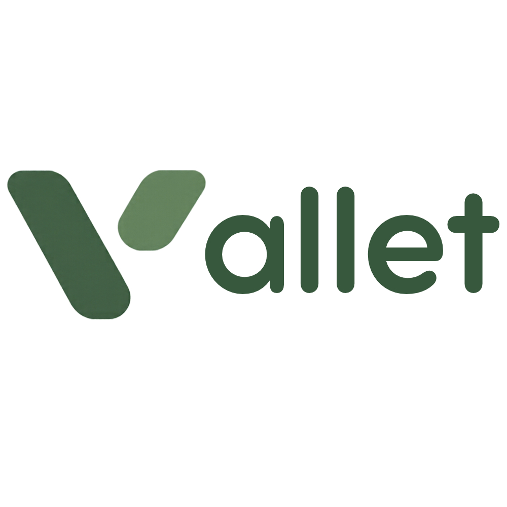

# ValletApp - Aplicação para Motoristas

<a href="https://git.io/typing-svg"></a>



O **ValletApp** é uma aplicação móvel desenvolvida para facilitar a gestão e a operação de motoristas em serviços de estacionamento. A aplicação permite o controlo em tempo real de vagas e a gestão eficiente de estacionamentos.

### 🔗 Ecossistema Vallet
Este repositório inclui o app completo para motoristas reservarem vagas. Conheça as outras partes do sistema:
* **[ValletWeb (Dashboards e Gestão)](https://github.com/Pereira-Sah/ValletWeb)**: Plataforma web para gestores de estacionamento.
* **[ValletIOT (Leitura de Placas)](https://github.com/Almile/ValletIOT)**: Sistema de leitura automatizada de placas usando webcam.

<br clear="both">

---

## Funcionalidades Principais
- Autenticação segura de utilizadores (Motoristas).
- Gestão e monitorização de vagas de estacionamento.
- Visualização detalhada de estacionamentos disponíveis e ocupados.
- Interface dinâmica com animações integradas.
- Atualização do estado dos veículos em tempo real.

## 🛠️ Tecnologias Utilizadas
- **Android SDK (Kotlin / Java)**
- **Arquitetura MVVM** (Model-View-ViewModel)
- **Firebase** (Realtime Database / Firestore, Autenticação)
- **Gradle** (Gerenciamento de dependências)

## 📂 Estrutura do Projeto
- `app/src/main/java/...`: Código-fonte do aplicativo, organizado seguindo o padrão MVVM (Models, Views/Activities/Fragments e ViewModels).
- `app/src/main/res/`: Recursos do projeto, incluindo layouts XML (`layout/`), imagens e ícones (`drawable/`, `mipmap/`) e valores globais (`values/`).
- `app/src/main/AndroidManifest.xml`: Arquivo de manifesto com as permissões e configurações principais do app.
- `build.gradle`: Arquivos de configuração do Gradle para gerenciar bibliotecas e dependências.

## Instalação e Execução

1. Clone o repositório para a sua máquina local:
   ```bash
   git clone https://github.com/lariiscriis/ValletProjeto.git
   ```
